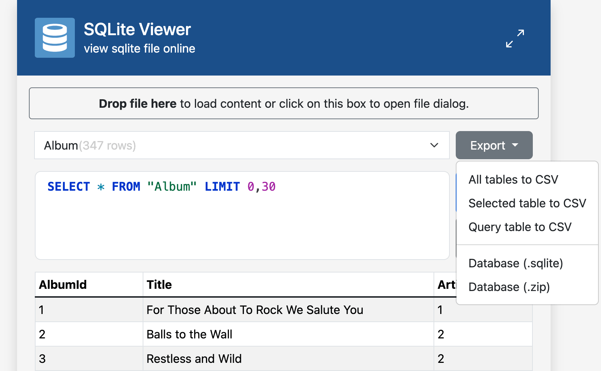

SQLite Viewer
=============

*View SQLite file online directly in your browser.*

The database will be loaded into your memory and changes will not affect the file you loaded it from. You can
however export the database after making changes.

You can also load remote files (using JS ajax, remote server must send `Access-Control-Allow-Origin:*`) 
and prefill a SQL query using hash parameters:

- To load a remote SQLite file upon page load, append<br>
  `#url=examples/Chinook_Sqlite.zip` to the URL. Both absolute and relative URLs work. So do zipped files.
- To prefill a SQL query, append<br>
  `#sql=SELECT%20*%20FROM%20table` to the URL.
- To load a remote file *and* prefill a query at the same time: Append both like this:<br>
  `#url=examples/Chinook_Sqlite.zip&sql=SELECT%20*%20FROM%20table`



Try [this live example](https://neuhaus.github.io/sqlite-viewer/#url=examples%2FChinook_Sqlite.zip&sql=SELECT+%0A++++Album.AlbumId%2C%0A++++Album.Title+AS+AlbumTitle%2C%0A++++Track.TrackId%2C%0A++++Track.Name+AS+TrackName%0AFROM+Album%0AJOIN+Track+ON+Album.AlbumId+%3D+Track.AlbumId%0AORDER+BY+Album.AlbumId%2C+TrackId%0ALIMIT+0%2C40%3B+)!

## Docker

You can run and configure the SQLite Viewer inside a lightweight production container using Docker.

### 1. Build the Docker Image
Execute the following build command in your workspace directory:
```bash
docker build -t sqlite-viewer -f docker/Dockerfile .
```

### 2. Auto-load a Database via Volume Mount
To mount your local database file or ZIP archive and have the application **automatically fetch and load it** on page load:
```bash
docker run --rm -p 8080:80 \
  -v "${PWD}/examples/Chinook_Sqlite.zip:/var/www/data.zip" \
  sqlite-viewer
```
*Note: Navigate to `http://localhost:8080` in your browser. The database tables will load instantly with zero user interaction.*

### 3. Configure Default SQL Query & Database URL
You can specify a custom database URL and auto-execute a default SQL query on startup using environment variables:
```bash
docker run --rm -p 8080:80 \
  -e DEFAULT_URL="examples/Chinook_Sqlite.zip" \
  -e DEFAULT_SQL="SELECT name, type FROM sqlite_master WHERE type='table' ORDER BY name;" \
  sqlite-viewer
```
* **`DEFAULT_URL`**: The database at this URL/path (relative path or absolute URL) will be fetched and opened on page load. Both raw databases and `.zip` archives are supported.
* **`DEFAULT_SQL`**: The code editor will be pre-populated and this query will execute automatically on startup.

## Building from source

The third-party libraries and the sample database are **not** stored in this
repository. Download the pinned versions before serving the site:

```bash
./scripts/fetch-assets.sh   # or: make deps
```

Then serve the directory over HTTP (the SQLite WASM backend does not work from
a `file://` URL), for example:

```bash
python3 -m http.server
```

The Docker image runs the download step automatically during the build.

## Libraries

- Using the official [sqlite3-wasm](https://sqlite.org/wasm/doc/trunk/index.md) for parsing sqlite files.
- Can handle SQLite files in ZIP files, thanks to [jszip](https://stuk.github.io/jszip/).
- Enjoy query editing with SQL syntax highlighting thanks to [CodeJar](https://medv.io/codejar/) and [PrismJS](https://prismjs.com/).
- Using [jQuery](https://jquery.com/) 4.0 slim, [Bootstrap](https://getbootstrap.com/) 5.3.8, [select2](https://select2.org/) and [FileSaver.js](https://github.com/eligrey/FileSaver.js/).

## License

Licensed under the Apache License, Version 2.0 — see [LICENSE](LICENSE) for details.
